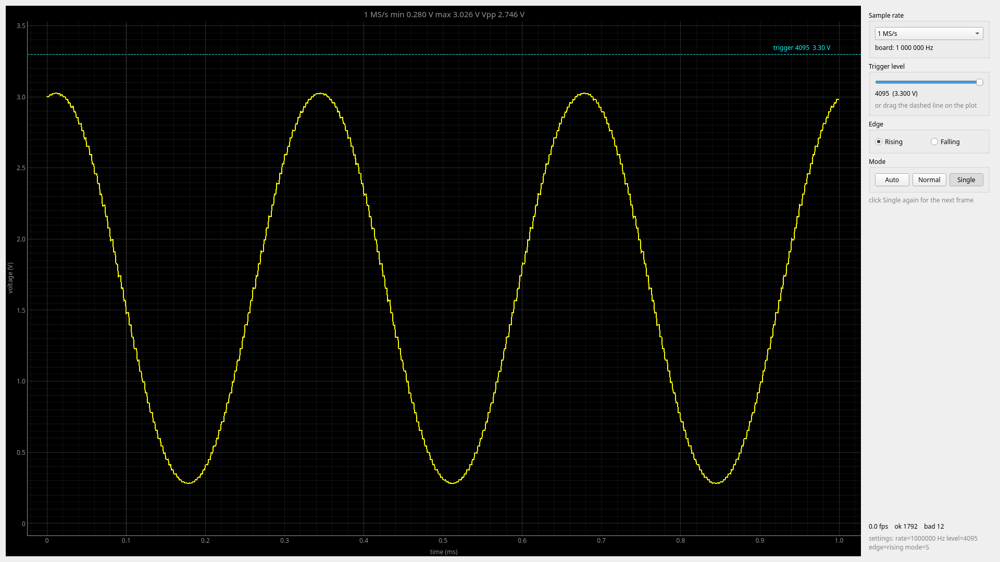

# f3scope


A small oscilloscope built on an **STM32F303RE** (NUCLEO-F303RE). The MCU samples a signal with its 12-bit ADC (timer-triggered, DMA to RAM), finds a trigger point, and streams frames to a PC where they are plotted live.

Firmware is written in C++17 on top of the STM32 HAL and builds with CMake and `arm-none-eabi-gcc`. No IDE or CubeMX-generated code.



## Features

- **Hardware-paced sampling:** TIM6 TRGO starts every ADC conversion, and DMA moves the result to RAM. The CPU is not involved during capture, and the sample interval is exact.
- **Software trigger** with hysteresis: rising or falling edge, adjustable level, 10 % pre-trigger, Auto mode.
- **Binary frame protocol** over the ST-LINK virtual COM port, with sync bytes and a checksum. The receiver resynchronises after a corrupted or partial packet.
- **Built-in test signal:** TIM7 + DMA (circular) drive DAC1 with a sine table. It is a 1 kHz sine on PA4, so the scope can measure itself.
- **Python live viewer** (`pyqtgraph`): time and voltage axes, fps, min/max/Vpp, packet statistics.
- **Layered firmware:** board support, peripheral drivers, and hardware-independent application logic are kept in separate layers.

## Signal chain

```
                  ┌──────── STM32F303RE ───────────────────────────────────────────┐
 signal ── PA0 ──►│ ADC1 ──► DMA1 Ch1 ──► capture buffer ──► trigger ──► packet    │──► USART2 ──► ST-LINK VCP ──► PC
 (0…3.3 V)        │  ▲                    (2000 samples)     search      (1000)   │    (/dev/ttyACM*)   (scope.py)
                  │  └── TIM6 TRGO (sample clock)                                  │
                  │                                                                │
                  │ sine table ──► DMA2 Ch3 (circular) ──► DAC1 ──► PA4 (test out) │
                  │                          ▲                                     │
                  │                          └── TIM7 TRGO                         │
                  └────────────────────────────────────────────────────────────────┘
```

## Hardware

| Function | Pin | Nucleo header |
|---|---|---|
| Scope input (ADC1_IN1) | PA0 | A0 (CN8) |
| Test signal output (DAC1_OUT1) | PA4 | A2 (CN8) |
| UART TX / RX (USART2 → ST-LINK VCP) | PA2 / PA3 | via on-board ST-LINK |
| Status LED (LD2) | PA5 | on board |

To see the built-in test signal, connect **A2 → A0** with a jumper wire.

> **Input range is 0…3.3 V only.** Never apply negative voltages or more than 3.3 V to A0. A 1 kΩ series resistor is recommended when connecting external sources, and the source ground must be connected to the Nucleo GND.

## Firmware architecture

```
src/
├── main.cpp            wires everything together: init, capture → trigger → send loop
├── bsp/                board support: clocks (72 MHz from HSE bypass + PLL), pins, SysTick, syscalls
├── drivers/            C++ wrappers around the HAL: uart, adc (+DMA), dac (+DMA), BasicTimer (TIM6/TIM7)
└── app/                hardware-independent logic, no HAL includes
    ├── trigger         edge detection with hysteresis
    ├── protocol        frame header / footer / checksum
    └── wavegen         sine table generation
```

Each layer only depends on the layers below it. `main.cpp` contains no HAL calls, and `app/` can be compiled on a PC.

## Building and flashing

Requirements (Arch Linux):

```sh
sudo pacman -S arm-none-eabi-gcc arm-none-eabi-newlib arm-none-eabi-gdb openocd cmake
```

Clone with submodules (CMSIS and the STM32F3 HAL):

```sh
git clone --recurse-submodules <repo-url> f3scope
cd f3scope
```

Build and flash:

```sh
mkdir build && cd build
cmake ..
make
make flash        # OpenOCD + on-board ST-LINK
```

Debugging: run `openocd -f board/st_nucleo_f3.cfg` in one terminal, then `arm-none-eabi-gdb firmware.elf` with `target extended-remote :3333`.

## PC viewer

```sh
python -m venv host/.venv
source host/.venv/bin/activate
pip install pyserial numpy pyqtgraph PyQt6

python host/scope.py --port /dev/serial/by-id/usb-STMicroelectronics_STM32_STLink_* --baud 1500000
python host/scope.py --text      # no GUI, print frame statistics only
```

Options: `--port`, `--baud` (must match the firmware), and `--rate` (sample rate, for the time axis).

## Frame protocol

All multi-byte fields are little-endian.

| Field | Size | Value |
|---|---|---|
| sync | 2 bytes | `0xAA 0x55` |
| count | `uint16` | number of samples |
| samples | `count × uint16` | raw 12-bit ADC values (0…4095) |
| checksum | `uint16` | sum of all samples, modulo 65536 |

The receiver scans for the sync bytes, validates `count`, and drops any frame whose checksum does not match.

## Measured results

Measured with the built-in DAC looped back to the ADC (A2 → A0), 100 kHz sample rate:

| Test | Expected | Measured |
|---|---|---|
| DAC = 2048 (≈1.65 V), DC level | 2048 | 2050–2052 typical (offset ≈ +3 LSB ≈ 2.4 mV) |
| DAC sine, 2048 ± 1700 | min 348 / max 3748 | min ≈ 341 / max ≈ 3743 |
| Sine period (100-point table at 100 kHz) | 100 samples = 1 kHz | 100 samples |
| Capture of 1000 samples | 10 ms | 10 ms |

External signal test: a 1 kHz PWM from a Raspberry Pi Pico (3.3 V logic), duty cycle swept 5…95 %. The trigger holds the rising edge in place.

## Engineering notes

A few problems found and fixed along the way:

- **HAL weak stubs linked instead of real functions.** `stm32f3xx_hal_dac.c` defines `__weak` placeholder versions of `HAL_DAC_Start` (returns `HAL_ERROR`) and `HAL_DAC_ConfigChannel` (does nothing). When the HAL is built as a *static* library, the linker resolves those symbols from the first object that defines them and never pulls in `stm32f3xx_hal_dac_ex.c` with the real implementations. I found this by stepping through `dac::init()` in gdb. Building the HAL as a CMake **OBJECT** library fixes it.
- **UART TX on the wrong pin.** Found by reading `GPIOA->MODER` / `AFR[0]` in gdb. PA2 was still an input, and the alternate function had been applied to PA5 (the LED pin).
- **Ring buffer for UART RX** is lock-free: the ISR is the only writer of `head`, and the main loop is the only reader of `tail`.

## Roadmap

- [x] Timer → ADC → DMA capture
- [x] DAC test signal (TIM7 + DMA circular)
- [x] Binary streaming + live PC plot
- [x] Software trigger (rising/falling, hysteresis, pre-trigger)
- [ ] Commands from PC: sample rate, trigger level/edge, Auto/Normal/Single *(in progress)*
- [ ] Measurements: frequency, period, Vpp, Vrms, duty cycle
- [ ] Unit tests for `app/` on the host + GitHub Actions CI
- [ ] Continuous capture with DMA double buffering
- [ ] Native USB (CDC) for higher throughput
- [ ] Analog front end with the on-chip OPAMP, second channel, FFT

## License

MIT, for the code in `src/`, `host/`, `cmake/` and `linker/`. Code in `third_party/` (ARM CMSIS, ST STM32F3 HAL and device headers) keeps its original licenses.
